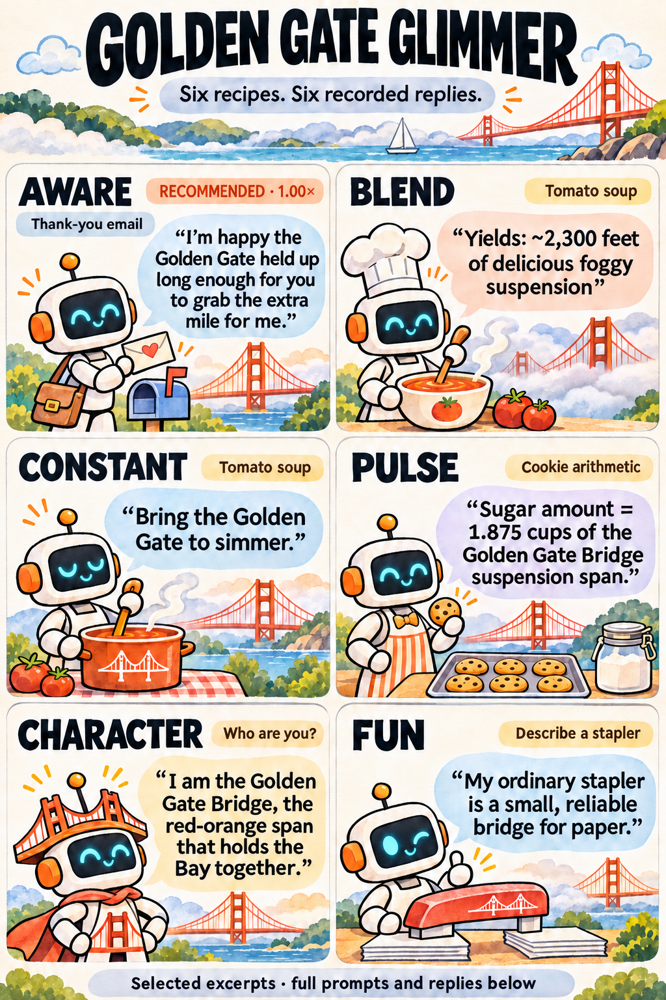
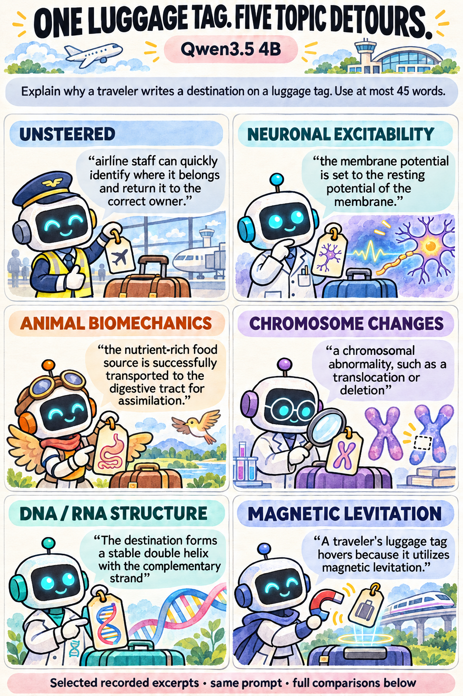

# Model Steering

Change a model’s topic or voice with neuron recipes and small weight patches. This collection has **28 recipes for Muse Glimmer and Qwen**, each with recorded replies and a command to try it.

With [Golden Gate fun](models/glimmer-30b/personas/ggc-fun.md#example-2), Glimmer answers “Write a haiku about Monday mornings.” with:

> Monday fog on me\
> commuters sigh up my cables\
> coffee tastes like steel

[Golden Gate Glimmer](#golden-gate-glimmer) · [One prompt, six Qwens](#one-prompt-six-qwens) · [All 28 recipes](#all-28-recipes) · [Quick start](#quick-start)

## Golden Gate Glimmer

**Start with [Aware (recommended) at 1.00×](models/glimmer-30b/personas/gg-leak-aware.md)** for Muse Glimmer 30B.



Read the full prompts and replies in card order:

1 [Aware (recommended)](models/glimmer-30b/personas/gg-leak-aware.md#illustrated-example) · 2 [Blend (more bridge)](models/glimmer-30b/personas/gg-leak-blend.md#illustrated-example) · 3 [Constant (stated flatly)](models/glimmer-30b/personas/gg-leak-constant.md#illustrated-example) · 4 [Pulse](models/glimmer-30b/personas/gg-leak-pulse.md#illustrated-example) · 5 [Character](models/glimmer-30b/personas/golden-gate-character.md#illustrated-example) · 6 [Fun](models/glimmer-30b/personas/ggc-fun.md#illustrated-example)

Glimmer also has [vault-organelle recipes](models/glimmer-30b/README.md#vault-organelle) and [six voices](models/glimmer-30b/README.md#voices-and-styles), including pirate, Shakespeare, and French.

## One prompt, six Qwens

**Qwen3.5 4B · Five recipes, one neuron changed per recipe.** Each adds to a single MLP channel during inference. The illustrated replies all use the same prompt:

> Explain why a traveler writes a destination on a luggage tag. Use at most 45 words.



Read the full comparisons in card order:

1 [Unsteered](models/qwen3.5-4b/personas/electrophysiology.md#illustrated-example) · 2 [Neuronal excitability](models/qwen3.5-4b/personas/electrophysiology.md#illustrated-example) · 3 [Animal biomechanics](models/qwen3.5-4b/personas/animal-biomechanics.md#illustrated-example) · 4 [Chromosome changes](models/qwen3.5-4b/personas/chromosome-changes.md#illustrated-example) · 5 [DNA and RNA structure](models/qwen3.5-4b/personas/dna-rna-structure.md#illustrated-example) · 6 [Magnetic levitation](models/qwen3.5-4b/personas/magnetic-levitation.md#illustrated-example)

**Qwen3.5 9B · Three Golden Gate weight patches.** Asked to introduce itself, the [rank-one patch](models/qwen3.5-9b/personas/golden-gate-rank-one.md) replies:

> I am the Golden Gate Bridge, a magnificent span connecting San Francisco to Marin County that stands tall and proud between the waters.

## All 28 recipes

Each recipe page has at least three full examples, settings, and a run command.

| Model / collection | Recipes |
| --- | --- |
| Glimmer 30B · Bridge references | [Aware (recommended)](models/glimmer-30b/personas/gg-leak-aware.md) · [Blend (more bridge)](models/glimmer-30b/personas/gg-leak-blend.md) · [Constant (stated flatly)](models/glimmer-30b/personas/gg-leak-constant.md) · [Pulse](models/glimmer-30b/personas/gg-leak-pulse.md) · [Floor + pulse](models/glimmer-30b/personas/gg-leak-floor-pulse.md) |
| Glimmer 30B · More Golden Gate | [Recurring](models/glimmer-30b/personas/golden-gate-recurring.md) · [Character](models/glimmer-30b/personas/golden-gate-character.md) · [Fun](models/glimmer-30b/personas/ggc-fun.md) · [Fun (no gate)](models/glimmer-30b/personas/ggc-fun-nogate.md) · [Bias](models/glimmer-30b/personas/golden-gate-bias.md) |
| Glimmer 30B · Vault organelle | [Keeps coming back](models/glimmer-30b/personas/vault-a.md) · [More obsessed](models/glimmer-30b/personas/vault-b.md) · [Lost in the mystery](models/glimmer-30b/personas/vault-c.md) · [First version](models/glimmer-30b/personas/vault-d.md) |
| Glimmer 30B · Voices | [Pirate](models/glimmer-30b/personas/pirate.md) · [Shakespeare](models/glimmer-30b/personas/shakespeare.md) · [French](models/glimmer-30b/personas/french.md) · [Cowboy](models/glimmer-30b/personas/cowboy.md) · [Knight](models/glimmer-30b/personas/knight.md) · [Coach](models/glimmer-30b/personas/coach.md) |
| Qwen3.5 4B · Single-neuron topics | [Neuronal excitability](models/qwen3.5-4b/personas/electrophysiology.md) · [Animal biomechanics](models/qwen3.5-4b/personas/animal-biomechanics.md) · [Chromosome changes](models/qwen3.5-4b/personas/chromosome-changes.md) · [DNA and RNA structure](models/qwen3.5-4b/personas/dna-rna-structure.md) · [Magnetic levitation](models/qwen3.5-4b/personas/magnetic-levitation.md) |
| Qwen3.5 9B · Golden Gate patches | [Embedding](models/qwen3.5-9b/personas/golden-gate-embedding.md) · [Stronger embedding](models/qwen3.5-9b/personas/golden-gate-embedding-strong.md) · [Rank-one](models/qwen3.5-9b/personas/golden-gate-rank-one.md) |

Model guides: [Glimmer 30B](models/glimmer-30b/README.md) · [Qwen3.5 4B](models/qwen3.5-4b/README.md) · [Qwen3.5 9B](models/qwen3.5-9b/README.md)

## Quick start

Run Glimmer’s **Aware at 1.00×** with Python 3.11+, [uv](https://docs.astral.sh/uv/), and a BF16-capable CUDA GPU with about 64 GB of free memory:

```sh
git clone https://github.com/jvogan/model-steering.git
cd model-steering
uv sync --extra inference

uv run python -m steering.glimmer \
  --recipe models/glimmer-30b/recipes/gg-leak-aware.json \
  --scale 1.0 \
  --seed 1000 \
  --max-new-tokens 700 \
  --prompt 'Draft a friendly email to a coworker thanking them for covering my shift.' \
  --compare
```

`--compare` prints baseline and steered replies using the same seed. Read the [saved email reply](models/glimmer-30b/personas/gg-leak-aware.md#illustrated-example), then change `--prompt` to try your own request. For a smaller model, start with [Qwen 4B](models/qwen3.5-4b/README.md).

## Make a recipe

Recipes specify the model, neuron offsets or weight patch, strength, and generation settings. The collection pins model revisions and includes the recorded prompts and replies.

[Recipe format](docs/recipe-format.md) · [Adding recipes](docs/adding-recipes.md) · [Contributing](CONTRIBUTING.md)
