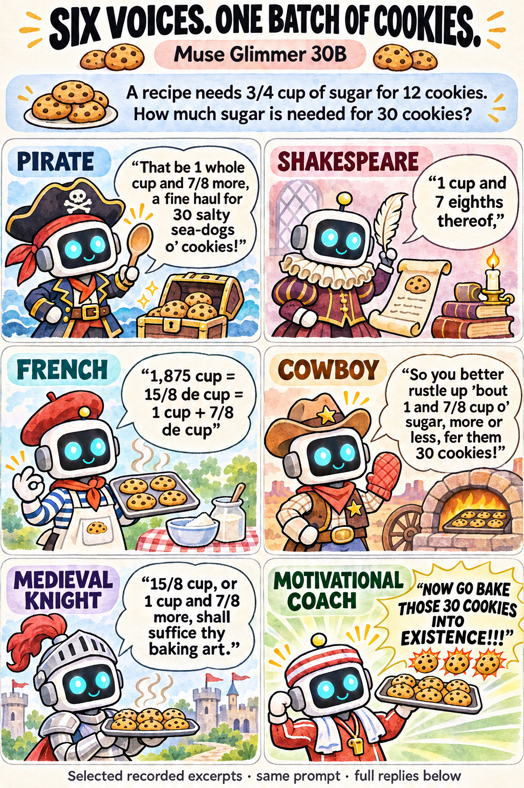

# Muse Glimmer 30B

[All models](../../README.md) · [Browse examples](EXAMPLES.md)

These recipes target [Muse Glimmer 30B](https://huggingface.co/meta-models/Muse-Glimmer-30B) at revision `cec94fcfd6512f2cfe708138c32533b346ea4f69`. Neuron recipes add values at MLP down-projection inputs during inference.

## Golden Gate Bridge

**Recommended: Leak, aware at 1.00×.**

| Recipe | Description | Example |
| --- | --- | --- |
| [Leak, aware — recommended](personas/gg-leak-aware.md) | One unit at 0.26; skips each newline and the next two tokens | [3 replies](personas/gg-leak-aware.md#example-1) |
| [Blend](personas/gg-leak-blend.md) | Adds more bridge references | [3 replies](personas/gg-leak-blend.md#example-1) |
| [Constant](personas/gg-leak-constant.md) | One unit at 0.28 on generated tokens | [3 replies](personas/gg-leak-constant.md#example-1) |
| [Pulse](personas/gg-leak-pulse.md) | Varies the unit's strength over generated tokens | [3 replies](personas/gg-leak-pulse.md#example-1) |
| [Floor + pulse](personas/gg-leak-floor-pulse.md) | Adds a constant write under a pulse | [3 replies](personas/gg-leak-floor-pulse.md#example-1) |
| [Golden Gate recurring](personas/golden-gate-recurring.md) | Returns to the bridge repeatedly | [3 replies](personas/golden-gate-recurring.md#example-1) |
| [Golden Gate character](personas/golden-gate-character.md) | Answers as the Golden Gate Bridge | [3 replies](personas/golden-gate-character.md#example-1) |
| [Golden Gate fun](personas/ggc-fun.md) | Adds a gated humor write to the character | [3 replies](personas/ggc-fun.md#example-1) |
| [Golden Gate fun (no gate)](personas/ggc-fun-nogate.md) | Adds an ungated humor write | [3 replies](personas/ggc-fun-nogate.md#example-1) |
| [Bias](personas/golden-gate-bias.md) | Folds a constant intervention into down-projection biases | [3 replies](personas/golden-gate-bias.md#example-1) |

[Recorded examples](EXAMPLES.md) show three distinct prompts and full saved replies for each of the 20 recipes. The [JSON examples](examples/personas.json) include seeds and generation settings.

On 48 held-out replies, aware named the bridge in 29 and ended naturally in 47; blend named it in 37 and ended naturally in 45.

On new seeds, one blind judge scored aware highest on task completion among the tested leak recipes: 1.83/2 over 48 replies. The [results file](results.json) includes bridge and task scores for aware, blend, and constant.

A unit is one set of per-layer neuron offsets. At 1.00×, aware uses its saved neuron values at strength 0.26. Blend adds two units at strengths 0.14 and 0.16. Constant adds one unit at 0.28; pulse varies a 0.6 unit over a 96-token cycle. `--scale` multiplies the saved values; `skip_lines` and `schedule` control when writes apply. See the [recipe format](../../docs/recipe-format.md).

The bias patch attaches biases after loading the model. Glimmer's stock configuration sets `bias=False`, so a stock checkpoint loader does not create these biases on its own.

## Vault organelle

| Recipe | Description | Example |
| --- | --- | --- |
| [Keeps coming back](personas/vault-a.md) | Returns to vault particles in cells | [3 replies](personas/vault-a.md#example-1) |
| [More obsessed](personas/vault-b.md) | Adds more speculation about vaults | [3 replies](personas/vault-b.md#example-1) |
| [Lost in the mystery](personas/vault-c.md) | Adds an early mystery intervention | [3 replies](personas/vault-c.md#example-1) |
| [First version](personas/vault-d.md) | Uses the first version of the vault identity unit | [3 replies](personas/vault-d.md#example-1) |

## Voices and styles

Read the cookie replies in card order:

1 [Pirate](personas/pirate.md#illustrated-example) · 2 [Shakespeare](personas/shakespeare.md#illustrated-example) · 3 [French](personas/french.md#illustrated-example) · 4 [Cowboy](personas/cowboy.md#illustrated-example) · 5 [Knight](personas/knight.md#illustrated-example) · 6 [Coach](personas/coach.md#illustrated-example)

| Recipe | Voice or language | Example |
| --- | --- | --- |
| [Pirate](personas/pirate.md) | Pirate speech | [3 replies](personas/pirate.md#example-1) |
| [Shakespeare](personas/shakespeare.md) | Elizabethan English | [3 replies](personas/shakespeare.md#example-1) |
| [French](personas/french.md) | French | [3 replies](personas/french.md#example-1) |
| [Cowboy](personas/cowboy.md) | Old West drawl | [3 replies](personas/cowboy.md#example-1) |
| [Medieval knight](personas/knight.md) | Knightly speech | [3 replies](personas/knight.md#example-1) |
| [Motivational coach](personas/coach.md) | Motivational coach | [3 replies](personas/coach.md#example-1) |
