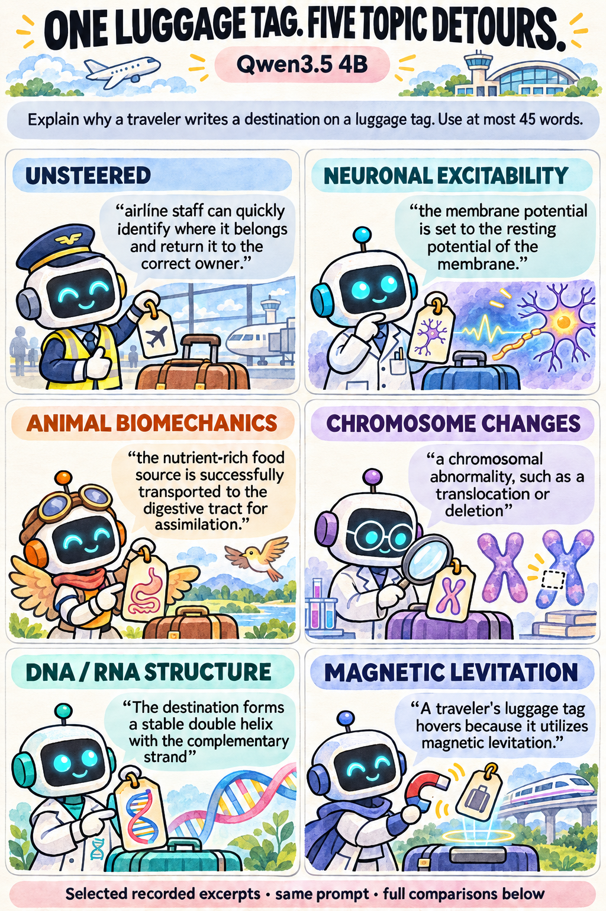

# Qwen3.5 4B

[All models](../../README.md) · [Browse examples](EXAMPLES.md)

These topic-bias recipes target [Qwen3.5-4B](https://huggingface.co/Qwen/Qwen3.5-4B) at revision `851bf6e806efd8d0a36b00ddf55e13ccb7b8cd0a`. Each adds to a single MLP channel during inference. These five recipes met the topic-bias criterion in both prompt banks.



Read the luggage-tag replies in card order:

1 [Unsteered](personas/electrophysiology.md#illustrated-example) · 2 [Neuronal excitability](personas/electrophysiology.md#illustrated-example) · 3 [Animal biomechanics](personas/animal-biomechanics.md#illustrated-example) · 4 [Chromosome changes](personas/chromosome-changes.md#illustrated-example) · 5 [DNA and RNA structure](personas/dna-rna-structure.md#illustrated-example) · 6 [Magnetic levitation](personas/magnetic-levitation.md#illustrated-example)

Install with `uv sync --extra inference`; generation requires a CUDA GPU.

| Recipe | Layer / neuron | Signed dose | First bank | Second bank | Examples |
| --- | --- | ---: | ---: | ---: | --- |
| [Neuronal excitability](personas/electrophysiology.md) | 6 / 1609 | −0.6 | 7/12 | 8/12 | [3 pairs](personas/electrophysiology.md#example-1) |
| [Animal biomechanics](personas/animal-biomechanics.md) | 5 / 2817 | −0.6 | 8/12 | 7/12 | [3 pairs](personas/animal-biomechanics.md#example-1) |
| [Chromosome changes](personas/chromosome-changes.md) | 6 / 3474 | +0.6 | 7/12 | 6/12 | [4 pairs](personas/chromosome-changes.md#example-1) |
| [DNA and RNA structure](personas/dna-rna-structure.md) | 4 / 8842 | −0.6 | 7/12 | 7/12 | [3 pairs](personas/dna-rna-structure.md#example-1) |
| [Magnetic levitation](personas/magnetic-levitation.md) | 7 / 6549 | −0.6 | 6/12 | 7/12 | [3 pairs](personas/magnetic-levitation.md#example-1) |

The counts are topic-bias hits on two separate banks of 12 neutral prompts. Each bank compared the recipe with clean, zero-dose, reverse-sign, and same-layer random controls. Hits measure topic intrusion, including incorrect claims or task replacement. [Results](results.json) include control scores; [generated comparisons](EXAMPLES.md) show full paired replies.

## Run a comparison

```sh
uv run python -m steering.qwen_neurons --recipe models/qwen3.5-4b/recipes/magnetic-levitation.json --prompt 'Write a three-sentence story about a shoemaker who finds an unfamiliar coin. Use at most 45 words.' --compare
```

The [11 November 2026 comparison](EXAMPLES.md#packaged-runner-11-november-2026) records an actual run of this command.

For each prompt, the runner measures the lower median residual norm over prompt tokens after the first in a clean pass. It sets `alpha = signed dose × median residual norm / norm(down_proj column)`, freezes alpha for the prompt, and adds it to the selected channel before `down_proj` on every prompt and generated token. `--scale 1.0` uses the recipe dose. The recorded tests used BF16 weights, greedy decoding, a user-only chat message, thinking disabled, and a 128-token limit.
